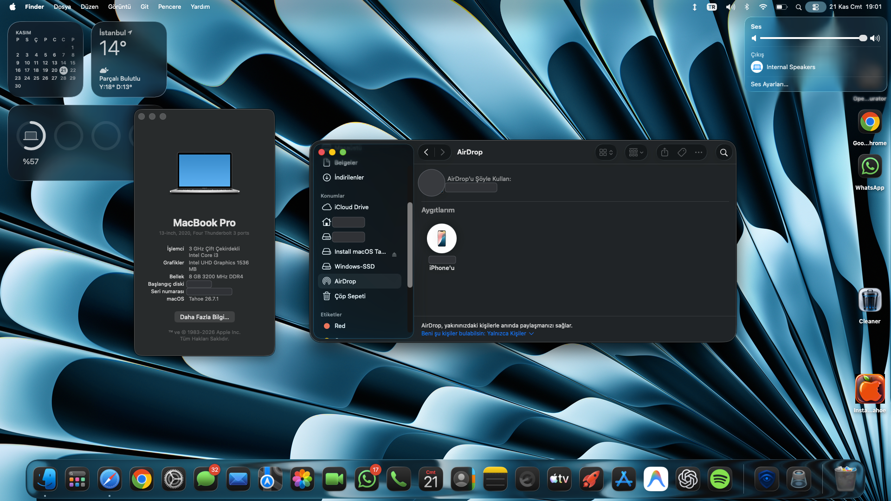

# Lenovo IdeaPad 3 15ITL6 Hackintosh EFI (macOS Tahoe)

[](https://github.com/acidanthera/OpenCorePkg)
[](https://www.apple.com/macos/)
[](https://github.com/b00t0x/WhateverXe)
[](https://github.com/retropineaple/ForbiddenItlwm)

Working OpenCore 1.0.8 EFI configuration for **Lenovo IdeaPad 3 15ITL6** (11th Gen Intel Tiger Lake / Intel UHD Graphics Xe-LP) running **macOS Tahoe 26.7.1 (25G241)**.



> [!IMPORTANT]
> **Generate Your Own SMBIOS Before Booting!**
> Personal identifiers (`SystemSerialNumber`, `MLB`, `SystemUUID`, and `ROM`) have been scrubbed from `EFI/OC/config.plist`. Before signing into iCloud, iMessage, or FaceTime, generate unique **`MacBookPro16,2`** SMBIOS values using [GenSMBIOS](https://github.com/corpnewt/GenSMBIOS) and fill them in under `PlatformInfo -> Generic`.

> [!WARNING]
> **Hardware-Specific Notes:**
> - **`EFI/OC/ACPI/MaLd0n.aml`** is tailored specifically to this **Lenovo IdeaPad 3 15ITL6** board. Do not reuse blindly on different laptop models.
> - **Do NOT add `NVMeFix.kext`** if your laptop has the stock **Samsung PM991** NVMe SSD — it is known to cause kernel panics/instability on PM991 drives.
> - **SIP / AMFI:** `csr-active-config` is set to `03080000` (`0x803`) so `AMFIAnchor` + `WhateverXe-Graphics` can load signed Intel Xe GPU bundles cleanly without globally disabling AMFI.

---

## Hardware Specifications

| Component | Model / Details |
|---|---|
| **Laptop** | Lenovo IdeaPad 3 15ITL6 (15.6" 1920x1080 FHD eDP) |
| **CPU** | Intel Core i3-1115G4 @ 3.00 GHz (11th Gen Tiger Lake-U, 2C / 4T) |
| **iGPU** | Intel UHD Graphics Xe-LP (`8086:9A78`, 48 EU, 1536 MB, Metal 2) |
| **RAM** | 8 GB DDR4-3200 MHz |
| **Storage** | 256 GB Samsung PM991 NVMe SSD (`MZALQ256HBJD-00BL2`, TRIM enabled) |
| **Wi-Fi** | Intel Wi-Fi 6 AX201 CNVi (`8086:A0F0`, `0x0234`) |
| **Bluetooth** | Intel Integrated Bluetooth (`8087:0AAA`) |
| **Audio** | Realtek ALC257 (`alcid=11`) + Intel SST Digital Mic (`8086:A0C8`) |
| **Touchpad** | ELAN I2C Precision Touchpad (`ELAN06FA`) |
| **Webcam** | Integrated USB UVC Camera (`04F2:B725`) |
| **SMBIOS** | `MacBookPro16,2` |

---

## What Works & Known Limitations

### Working
- **Full Metal 2 / QE-CI Graphics Acceleration:** Smooth UI, transparency/Liquid Glass, video playback (`WhateverXe 0.8.3` + `WhateverXe-Graphics 0.4.4` + `AMFIAnchor 0.1.2`).
- **Display & Brightness:** Native 1080p eDP display, macOS brightness slider, and `Fn` brightness keys (`BrightnessKeys.kext`).
- **Wi-Fi & AWDL:** Native macOS Wi-Fi menu + AirDrop (`ForbiddenItlwm 0.6.0-beta.3`).
- **Bluetooth & Continuity:** Bluetooth audio/peripherals (`IntelBluetoothFirmware 2.5.3` + `BlueToolFixup 2.7.3` + `BTLEAdvFixup 0.9.3`), AirDrop, iMessage, FaceTime (two-way video/audio), iCloud, iPhone Continuity Camera & Microphone.
- **Audio & Internal Mic:** Internal speakers & 3.5mm combo jack (`AppleALC 1.9.8` `alcid=11` + `SimpleHDA 1.0.1`), plus working built-in Intel SST digital microphone (`TGLDmic 0.5.0` pre-built with local `dma-reserve-1` patch in [`extras/tgldmic-dma-reserve-1.patch`](extras/tgldmic-dma-reserve-1.patch)).
- **Input:** Multi-touch Precision Trackpad gestures & three-finger drag (`VoodooI2C 2.9.1` + `VoodooI2CHID` + `SSDT-TPD0.aml`) + built-in keyboard (`VoodooPS2Controller 2.3.7`).
- **Power & USB:** Battery readout & cycle stats (`VirtualSMC` + `SMCBatteryManager` + `ECEnabler`), CPU power management (`CPUFriend` + `CPUFriendDataProvider` + `CpuTscSync`), and USB 2.0 port mapping (`USBToolBox` + `UTBMap` for 2x USB-A, 1x USB-C, camera, Bluetooth).

### Known Limitations / Quirks
- **Hardware H.264/HEVC Encoding (`VCS0`) Disabled:** `IOGVAEncoderRestricted = <01000000>` is injected on `IGPU` (`PciRoot(0x0)/Pci(0x2,0x0)`) to avoid the upstream Tiger Lake `WhateverXe` `VCS0` GPU reset/freeze bug during video calls (`#137` / `#159`). Software encoding keeps FaceTime and WhatsApp video calls stable, though screen sharing uses extra CPU on the dual-core i3.
- **FaceTime Screen Sharing:** Does not transmit frames when HW H.264 encoding is disabled (Apple `VCPRealtimeEncoder` SW-fallback limitation; two-way camera calls work).
- **Deep Sleep (S0ix):** Display sleep/wake uses `-nodisplaysleepDC6 -noDC9 dc6config=0`; full S0ix sleep is not yet configured.
- **Speaker + Internal Mic Echo:** Built-in SST mic works reliably, but acoustic echo cancellation with internal speakers is not automatic in all apps (headphones/AirPods have no echo).
- **USB Port Mapping:** Mapped as USB 2.0 on external ports (USB 3.0 SuperSpeed mapping is omitted).
- **High `WindowServer` CPU During Screen Sharing:** Upstream `WhateverXe-Graphics 0.4.4` `impostor.dylib` `dladdr` overhead (`WhateverXe #147`).

---

## Post-Install Setup

1. **Install WhateverXe-Graphics & AMFIAnchor (Required for Metal Acceleration):**
   - Install **WhateverXe-Graphics `v0.4.4`** (`Common` + `Tahoe` packages) from [`b00t0x/WhateverXe-Graphics`](https://github.com/b00t0x/WhateverXe-Graphics/releases) following its `AMFIAnchor` instructions.
2. **Apply Video Call Stability Defaults (Recommended):**
   - Run the included helper script in Terminal:
     ```bash
     bash extras/post-install-video-fix.sh
     ```
   - This sets `disableVDENC = true` and `FaceTimeEncoder = sw` / `FaceTimeDecoder = sw` so FaceTime (including incoming iPhone HEVC video) and WhatsApp calls avoid `AppleGVA`/`VCS0` hangs.
3. **Optional Extras (`extras/`):**
   - **[`extras/powerbutton-shutdown/`](extras/powerbutton-shutdown/):** Dialog-free physical power button shutdown LaunchDaemon (`sudo bash install.sh`).
   - **[`extras/ws-priority-guard/`](extras/ws-priority-guard/):** Lightweight LaunchDaemon keeping `WindowServer` prioritized (`nice -12`) and throttling background indexers during screen sharing (`sudo bash install.sh`).
   - **[`extras/tgldmic-dma-reserve-1.patch`](extras/tgldmic-dma-reserve-1.patch):** Source patch already compiled into `EFI/OC/Kexts/TGLDmic.kext` that pre-reserves the SST DSP DMA buffers so repeated mic start/stop cycles succeed.

---

## Kexts & Credits

| Component | Version | Source / Maintainer |
|---|---|---|
| OpenCore | 1.0.8 | [Acidanthera](https://github.com/acidanthera/OpenCorePkg) |
| WhateverXe + AMFIAnchor + Graphics | 0.8.3 / 0.1.2 / 0.4.4 | [b00t0x](https://github.com/b00t0x/WhateverXe) |
| ForbiddenItlwm + BTLEAdvFixup | 0.6.0-beta.3 / 0.9.3 | [retropineaple](https://github.com/retropineaple/ForbiddenItlwm) |
| Lilu / VirtualSMC / CPUFriend / AppleALC / BrcmPatchRAM / VoodooPS2 / CpuTscSync / RestrictEvents / BrightnessKeys | 1.7.2 / 1.3.8 / 1.3.0 / 1.9.8 / 2.7.3 / 2.3.7 / 1.1.2 / 1.1.6 / 1.0.3 | [Acidanthera](https://github.com/acidanthera) |
| IntelBluetoothFirmware | 2.5.3 | [OpenIntelWireless](https://github.com/OpenIntelWireless/IntelBluetoothFirmware) |
| TGLDmic (with `dma-reserve-1` patch) & SimpleHDA | 0.5.0 / 1.0.1 | Community Intel SST / HDA Projects |
| VoodooI2C + VoodooI2CHID | 2.9.1 | [VoodooI2C](https://github.com/VoodooI2C/VoodooI2C) |
| USBToolBox + UTBMap | 1.2.0 | [USBToolBox](https://github.com/USBToolBox/kext) |
| ECEnabler | 1.0.6 | [1Revenger1](https://github.com/1Revenger1/ECEnabler) |
